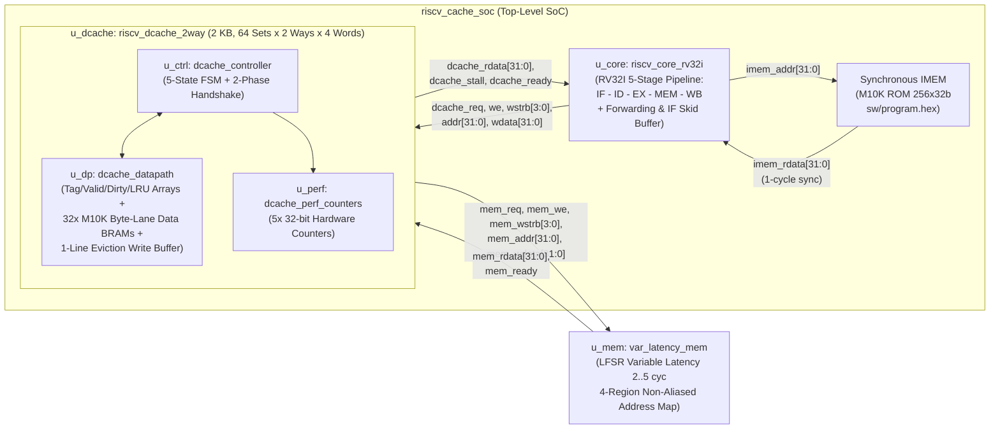
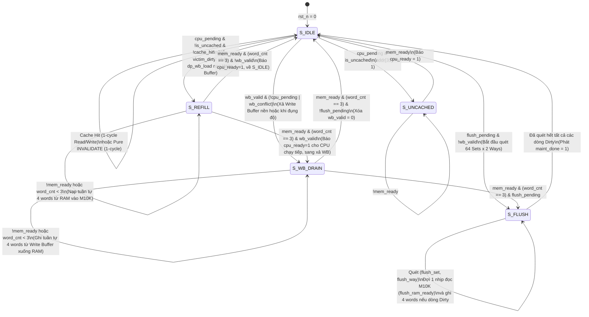

# BÁO CÁO KỸ THUẬT ĐỒ ÁN 2 (ĐA2)
## Thiết kế Cache 2-Way Set-Associative có Chính sách Ghi Rõ ràng & Write Buffer tích hợp Lõi RISC-V RV32I Pipeline 5 tầng

---

## 1. Tổng quan & Mục tiêu Thiết kế

Đồ án 2 (**ĐA2**) thuộc chuỗi đề tài **U14 — Cache cho lõi RISC-V và accelerator chia sẻ bộ nhớ** với lộ trình phát triển kế thừa chặt chẽ:
1. **ĐA1 ([`minimal/`](file:///c:/Users/HUY/Desktop/DATN/minimal))**: Thiết kế Cache Direct-Mapped nhỏ bằng RTL (`Tag/Data Array`, `Hit/Miss`, `Refill`), kiểm chứng với mô hình bộ nhớ có độ trễ biến thiên.
2. **ĐA2 ([`rtl/`](file:///c:/Users/HUY/Desktop/DATN/rtl), [`sw/`](file:///c:/Users/HUY/Desktop/DATN/sw), [`tb/`](file:///c:/Users/HUY/Desktop/DATN/tb))**: Nâng cấp lên **Cache 2-Way Set-Associative (2 KB)** với chính sách thay thế **LRU (Least Recently Used)**, chính sách ghi **Write-Back + Write-Allocate**, **Write Buffer 1 dòng (Eviction Buffer)**, tích hợp vào **Lõi RISC-V RV32I Pipeline 5 tầng** để thực thi chương trình C biên dịch bằng **RISC-V GCC (`C -> ELF -> HEX`)**, đồng thời tối ưu kiến trúc bộ nhớ đồng bộ suy diễn **M10K Block RAM** trên FPGA **DE10-Standard (`Cyclone V 5CSXFC6D6F31C6`)**.
3. **Chuẩn bị sẵn sàng cho ĐATN (Tích hợp DMA)**: Bổ sung cơ chế bảo trì nhất quán dữ liệu phần cứng (`CLEAN`, `Conditional INVALIDATE`, `CLEAN_INVALIDATE`), vùng nhớ **Uncached / MMIO** không alias địa chỉ và bộ chuyển đổi giao thức 2 pha độc lập ([`dcache_req_rsp_adapter.v`](file:///c:/Users/HUY/Desktop/DATN/rtl/dcache_req_rsp_adapter.v)).

---

## 2. Sơ đồ Kiến trúc Hệ thống & Vi kiến trúc D-Cache

### 2.1. Sơ đồ Khối Toàn Hệ thống SoC ([`riscv_cache_soc.v`](file:///c:/Users/HUY/Desktop/DATN/rtl/riscv_cache_soc.v))



### 2.2. Tổ chức Tham số & Phân rã Địa chỉ 32-bit

Cache có dung lượng **2 KB**, tổ chức thành **64 Sets $\times$ 2 Ways $\times$ 4 Words/Line (16 Bytes/Line)**:

| Trường địa chỉ | Vị trí Bit | Độ rộng | Ý nghĩa |
| :--- | :---: | :---: | :--- |
| **`Uncached Bit`** | `addr[31]` | 1 bit | `0`: Vùng nhớ Cacheable (`0x0000_0000 .. 0x0000_BFFF`)<br>`1`: Vùng nhớ Uncached / MMIO (`0x8000_0000+`), đi vòng qua Cache (`S_UNCACHED`) |
| **`Tag`** | `addr[31:10]` | 22 bits | Định danh dòng nhớ trong mỗi Set (so sánh song song với `tag_array[set][0]` và `tag_array[set][1]`) |
| **`Set Index`** | `addr[9:4]` | 6 bits | Chọn 1 trong 64 Sets (`0 .. 63`) |
| **`Word Offset`** | `addr[3:2]` | 2 bits | Chọn 1 trong 4 Words (32-bit) trong một Cache Line (`0 .. 3`) |
| **`Byte Offset`** | `addr[1:0]` | 2 bits | Chọn Byte/Halfword trong Word (kết hợp với `cpu_wstrb[3:0]`) |

### 2.3. Bản đồ Địa chỉ SoC Không Alias ([`var_latency_mem.v`](file:///c:/Users/HUY/Desktop/DATN/tb/var_latency_mem.v))

| Vùng địa chỉ | Kích thước | Thuộc tính | Ánh xạ Vật lý trong `var_latency_mem` |
| :--- | :---: | :---: | :--- |
| `0x0000_0000 .. 0x0000_BFFF` | 48 KB | **Cacheable** (`bit[31]=0`) | Main RAM `ram[14'h0000 .. 14'h2FFF]` (12,288 words) |
| `0x8000_0000 .. 0x8000_3FFF` | 16 KB | **Uncached** (`bit[31]=1`) | Shared RAM / DMA Buffer `ram[14'h3000 .. 14'h3FFF]` (4,096 words tách biệt hoàn toàn với vùng Cacheable) |
| `0x8001_0000 .. 0x8001_003F` | 64 B | **Uncached MMIO** (`bit[31]=1`) | Thanh ghi điều khiển ngoại vi / DMA `mmio_regs[0:15]` |
| Địa chỉ ngoài 3 vùng trên | — | **Invalid** | Báo cờ `addr_error = 1`, chặn ghi và trả về `0xDEAD_BAD0` |

---

## 3. Máy Trạng Thái Hữu Hạn (FSM) của Cache Controller ([`dcache_controller.v`](file:///c:/Users/HUY/Desktop/DATN/rtl/dcache_controller.v))

### 3.1. Sơ đồ Chuyển Trạng thái (5 Trạng thái)



### 3.2. Mô tả Chi tiết Từng Trạng thái & Phối hợp với M10K Block RAM

1. **`S_IDLE` (`3'd0`)**:
   - Cổng đọc của 32 khối M10K Block RAM luôn hướng vào `rd_set = req_index`.
   - **Khi Read-Hit**: Phát xung `dp_hit_rd = 1`, `cpu_ready <= 1`, `cpu_stall = 0`. Tại sườn lên xung nhịp kế tiếp, thanh ghi đầu ra `rdata_q` của M10K xuất đúng word vừa đọc qua `hit_rdata_mux` ra thẳng `cpu_rdata` (đảm bảo **độ trễ Hit = 1 chu kỳ, 0 chu kỳ Stall**).
   - **Khi Write-Hit**: Phát xung `dp_hit_wr = 1`, ghi trực tiếp vào các ngân hàng byte-lane (`bank_b0..b3`) tương ứng với `cpu_wstrb[3:0]` trong **1 chu kỳ duy nhất**, đặt `dirty_array[set][hit_way] <= 1'b1` và cập nhật `lru_bit[set] <= ~hit_way`.
   - **Khi Cache Miss**:
     - Nếu `wb_valid == 1` và xảy ra xung đột (`victim_dirty == 1` cần dùng Write Buffer hoặc `wb_hit == 1`), FSM chuyển sang `S_WB_DRAIN` để xả sạch Write Buffer trước.
     - Ngược lại, chốt yêu cầu CPU vào thanh ghi `req_*_q` (`dp_latch_req = 1`). Nếu dòng bị thay thế đang bẩn (`victim_dirty == 1`), phát `dp_wb_load = 1` (để chu kỳ sau `wb_load_d1` chốt toàn bộ 4 words từ `rdata_q` của M10K vào `wb_data[0..3]`) và nhảy **thẳng sang `S_REFILL`** để nạp ngay dòng mới cho CPU.
2. **`S_REFILL` (`3'd1`)**:
   - Đọc tuần tự 4 words (`word_cnt = 0 .. 3`) của dòng nhớ mới từ RAM vào `saved_victim_way`.
   - **Xử lý Write-Miss ngay trên đường nạp (On-the-fly Write Merge)**: Tại chu kỳ nhận word trùng với `req_word` (`word_cnt == req_word`), nếu là lệnh ghi (`eff_we == 1`), mạch trộn trực tiếp `apply_wstrb(mem_rdata, eff_wdata, eff_wstrb)` trước khi ghi vào M10K và đặt `dirty = 1`. Nếu là lệnh đọc (`!eff_we`), dữ liệu `mem_rdata` được chốt thẳng vào `cpu_rdata_q`.
   - Khi nhận xong word thứ 4 (`word_cnt == 3` và `mem_ready == 1`), Controller bật `cpu_ready <= 1` giải phóng CPU ngay lập tức, rồi chuyển sang `S_WB_DRAIN` nếu `wb_valid == 1` (hoặc về `S_IDLE` nếu `!wb_valid`).
3. **`S_WB_DRAIN` (`3'd2`)**:
   - Ghi trả tuần tự 4 words (`word_cnt = 0 .. 3`) từ `wb_data[0..3]` xuống RAM tại địa chỉ `wb_base_addr`. Khi hoàn tất word thứ 4, phát `dp_wb_clear = 1` xóa `wb_valid <= 0`.
4. **`S_UNCACHED` (`3'd3`)**:
   - Phục vụ các truy cập có `addr[31] == 1` (Shared RAM hoặc MMIO). Truyền trực tiếp 1 word giữa CPU và bus bộ nhớ mà không cấp phát dòng hay làm xáo trộn trạng thái `valid`/`dirty`/`lru` của Cache.
5. **`S_FLUSH` (`3'd4`)**:
   - Thực thi lệnh bảo trì `CLEAN` hoặc `CLEAN_INVALIDATE`. Bộ tìm kiếm tổ hợp (`next_dirty_found`) định vị ngay `(set, way)` bẩn kế tiếp.
   - Do `data_array` nằm trong M10K đồng bộ, FSM dùng cờ `flush_ram_ready` đợi 1 chu kỳ để M10K đọc dòng tại `rd_set = flush_set`, sau đó phát tuần tự 4 lệnh ghi xuống RAM và xóa `dirty_array[flush_set][flush_way] <= 0`. Chỉ khi toàn bộ Write Buffer và các dòng bẩn đã ghi xong xuôi xuống RAM, `maint_done` mới bật lên `1`.

---

## 4. Giao tiếp CPU – Cache – RAM & Chuẩn hóa Giao thức 2 Pha

### 4.1. Giao tiếp Lõi RV32I – D-Cache & Chốt Yêu cầu (`req_*_q`)
- Toàn bộ tín hiệu từ tầng MEM của Lõi RV32I (`dcache_addr`, `dcache_wdata`, `dcache_wstrb`, `dcache_we`) xuất phát trực tiếp từ thanh ghi đường ống `EX/MEM`, cắt đứt đường tổ hợp từ ALU sang bộ so sánh Tag của Cache.
- Ngay khi phát hiện Miss hoặc Uncached trong `S_IDLE`, Datapath chốt toàn bộ yêu cầu vào thanh ghi nội bộ (`req_addr_q`, `req_wdata_q`, `req_wstrb_q`, `req_we_q`) và bật `req_latched_q <= 1`. Nhờ đó, giao dịch đã được chấp nhận sẽ chạy đến khi hoàn tất mà không phụ thuộc việc Master bên ngoài có giữ nguyên tín hiệu trong suốt thời gian chờ hay không.

### 4.2. Bộ Chuyển đổi Giao thức 2 Pha Độc lập ([`dcache_req_rsp_adapter.v`](file:///c:/Users/HUY/Desktop/DATN/rtl/dcache_req_rsp_adapter.v))
- Để tái sử dụng D-Cache với bất kỳ Bus Master / DMA Arbiter chuẩn AXI-Stream / Valid-Ready nào trong ĐATN, module `dcache_req_rsp_adapter` tách giao tiếp thành 2 kênh độc lập:
  - **Kênh Request**: `req_valid` & `req_ready` (chấp nhận yêu cầu tại sườn lên `clk` khi `req_valid && req_ready`).
  - **Kênh Response**: `rsp_valid` & `rsp_rdata` (báo hoàn tất giao dịch).
- Tích hợp **1-entry Skid Buffer** cho phép Master phát yêu cầu mới (`req_valid = 1`) **ngay trong cùng chu kỳ giao dịch trước đang trả kết quả (`rsp_valid = 1`)** với thông lượng 100% (0 chu kỳ chết).

### 4.3. Giao tiếp D-Cache – Bộ nhớ Chính (`var_latency_mem`)
- Tuân thủ nghiêm ngặt quy tắc **Valid-Ready Handshake dưới Backpressure**: một khi `mem_req` đã kéo lên `1`, toàn bộ các đường `mem_we`, `mem_addr`, `mem_wdata`, `mem_wstrb` được giữ nguyên bất biến cho tới chu kỳ `mem_ready == 1` (được kiểm chứng tự động ở mọi chu kỳ xung nhịp bằng **Protocol Assertions**).

---

## 5. Nguyên lý Thay thế LRU 2 Chiều & Chính sách Ghi Write-Back + Write Buffer

### 5.1. Thuật toán Thay thế True LRU 2-Way (1-bit per Set)
Mỗi Set $s \in [0..63]$ có 1 bit trạng thái `lru_bit[s]`:
- `lru_bit[s] == 0`: **Way 0** là *Least Recently Used (LRU)*, **Way 1** là *Most Recently Used (MRU)*.
- `lru_bit[s] == 1`: **Way 1** là *Least Recently Used (LRU)*, **Way 0** là *Most Recently Used (MRU)*.

**Quy tắc chọn `victim_way` khi Miss tại Set $s$**:
$$\text{victim\_way} = \begin{cases} 0 & \text{nếu } \text{valid}[s][0] = 0 \text{ (ưu tiên nạp vào Way 0 đang trống)} \\ 1 & \text{nếu } \text{valid}[s][0] = 1 \land \text{valid}[s][1] = 0 \text{ (nạp vào Way 1 đang trống)} \\ \text{lru\_bit}[s] & \text{nếu cả 2 Way đều đã hợp lệ (thay thế đúng Way LRU)} \end{cases}$$

**Quy tắc cập nhật `lru_bit[s]`**:
- Khi **Hit tại Way $w \in \{0, 1\}$**: đặt `lru_bit[s] <= ~w` (Way vừa truy cập trở thành MRU, Way còn lại trở thành LRU).
- Khi **Refill hoàn tất vào `saved_victim_way`**: đặt `lru_bit[s] <= ~saved_victim_way`.

### 5.2. Cơ chế Write-Back + Write-Allocate kết hợp Write Buffer 1 Dòng
- **Khi không có Write Buffer (như ở ĐA1)**: Mỗi lần Miss đụng phải dòng `Dirty`, CPU phải chịu phạt kép: đợi 4 lần ghi dòng cũ xuống RAM (`S_WRITEBACK`) rồi mới được đọc 4 lần dòng mới từ RAM (`S_ALLOCATE`).
- **Khi có Eviction Write Buffer 1 dòng (ĐA2)**:
  1. Tại chu kỳ phát hiện Miss trên dòng `Dirty`, lệnh đọc/ghi của CPU được ưu tiên chuyển **ngay lập tức sang `S_REFILL`** để lấy dữ liệu mới từ RAM.
  2. Song song đó, 4 words của dòng bẩn từ M10K được chốt vào `wb_data[0..3]` (`wb_valid = 1`).
  3. Ngay khi word thứ 4 của `S_REFILL` về tới Cache, Controller bật `cpu_ready = 1` cho phép Pipeline CPU tiếp tục thực thi các lệnh tính toán hoặc Cache Hit kế tiếp, trong khi FSM âm thầm xả `wb_data[0..3]` xuống RAM ở trạng thái `S_WB_DRAIN`.
  4. Nếu CPU phát sinh truy cập trùng đúng dòng đang nằm trong Write Buffer (`wb_hit == 1`), Controller tự động xả xong Write Buffer trước rồi mới phục vụ CPU để bảo toàn thứ tự dữ liệu mới nhất.

---

## 6. Quy trình Biên dịch Phần mềm `C -> ELF -> HEX` & Hai Chương trình Benchmark

### 6.1. Quy trình Biên dịch Chuẩn bằng RISC-V GCC ([`sw/build_sw.sh`](file:///c:/Users/HUY/Desktop/DATN/sw/build_sw.sh))
Toàn bộ chương trình C trong thư mục [`sw/`](file:///c:/Users/HUY/Desktop/DATN/sw) được biên dịch tự động bằng bộ công cụ chuẩn **`riscv64-unknown-elf-gcc`** (kiến trúc đích `-march=rv32i -mabi=ilp32 -O2`):

```bash
# 1. Biên dịch và liên kết C + Startup Assembly (start.S) -> File thực thi ELF (.elf)
riscv64-unknown-elf-gcc -march=rv32i -mabi=ilp32 -O2 -fno-unroll-loops \
    -fno-tree-loop-distribute-patterns -ffreestanding -nostdlib \
    -T sw/link.ld -Wl,--no-relax sw/start.S sw/benchmark_da2.c -o sw/benchmark_da2.elf

# 2. Xuất file hợp ngữ giải mã (.dump) để đối chiếu mã máy RV32I
riscv64-unknown-elf-objdump -d -M no-aliases sw/benchmark_da2.elf > sw/benchmark_da2.dump

# 3. Trích xuất ảnh nhị phân phẳng (.bin) và chuyển thành mã máy 32-bit (.hex) nạp vào IMEM
riscv64-unknown-elf-objcopy -O binary sw/benchmark_da2.elf sw/benchmark_da2.bin
python3 sw/bin2hex.py sw/benchmark_da2.bin sw/program.hex
```

### 6.2. Hai Kịch bản Benchmark Đánh giá Khách quan
Để tránh đánh giá phiến diện chỉ trên một mẫu truy cập, hệ thống được kiểm chứng trên **hai chương trình C có đặc trưng tải trái ngược nhau**:

1. **Benchmark 1 — Workload Xung đột Cao / Thrashing ([`sw/benchmark_da2.c`](file:///c:/Users/HUY/Desktop/DATN/sw/benchmark_da2.c) $\rightarrow$ [`sw/program.hex`](file:///c:/Users/HUY/Desktop/DATN/sw/program.hex))**:
   - Cấp phát 4 mảng `A[8]` (`0x0100`), `B[8]` (`0x0900`), `C[8]` (`0x1100`), `D[4]` (`0x1900`) cách nhau đúng bội số **2 KB (`0x800`)**, ánh xạ vào **cùng Set 16..17** trên cả Cache 1 KB (64 sets) và Cache 2 KB (128 sets).
   - Kiểm chứng: (1) Xóa bỏ xung đột Ping-Pong khi cộng `B[i] = A[i] + B[i]` (24 lần truy cập đạt **100% Hit** trên 2-Way), (2) Thay thế LRU cả 2 chiều (trục xuất Way 0 chứa `A` khi nạp `C`, sau đó trục xuất Way 1 chứa `B` khi nạp `D`), và (3) Ghi/đọc mức Byte/Halfword (`SH`, `SB`, `LW` tạo giá trị `0xBEEF1234`).

2. **Benchmark 2 — Workload Tuần tự & Ít Xung đột ([`sw/benchmark_seq.c`](file:///c:/Users/HUY/Desktop/DATN/sw/benchmark_seq.c) $\rightarrow$ [`sw/program_seq.hex`](file:///c:/Users/HUY/Desktop/DATN/sw/program_seq.hex))**:
   - Cấp phát 3 mảng liên tiếp trong bộ nhớ: `X[16]` (`0x0400..0x043C`, Set 16..19), `Y[16]` (`0x0440..0x047C`, Set 20..23) và `Z[16]` (`0x0480..0x04BC`, Set 24..27).
   - Thực hiện 3 vòng lặp tuần tự: khởi tạo `X, Y`, tính tổng vector `Z[i] = X[i] + Y[i]` (`sum_z = 1496 = 0x5D8`) và quét lại bộ lọc `filter_acc += Z[i] - X[i]` (`1360 = 0x550`).
   - Do các mảng nằm trên các Set hoàn toàn tách biệt (`Set 16..27`), không xảy ra Conflict Miss; chương trình đánh giá khách quan độ lợi **Spatial Locality** (4 words/line: 1 Cold Miss phục vụ 3 Hits kế tiếp) và **Temporal Locality** trên cả Direct-Mapped lẫn 2-Way.

---

## 7. Kết quả Kiểm thử Testbench & Bảng Đánh giá Hiệu năng / PPA

### 7.1. Tổng hợp Kết quả Kiểm thử Hồi quy (ModelSim)

| Bộ Testbench | Số lượng Test | Protocol Assertions | Kết quả | Nội dung kiểm chứng trọng tâm |
| :--- | :---: | :---: | :---: | :--- |
| **[`tb_riscv_dcache_2way.v`](file:///c:/Users/HUY/Desktop/DATN/tb/tb_riscv_dcache_2way.v)** | **35 / 35** | **897 PASSED** | **100% PASS** | T1..T18: Cold Miss, Spatial Locality, Read/Write Hit, Byte/Halfword Strobe, 2-Way No-Conflict, LRU Eviction Way 0 & Way 1, Write Buffer Drain & Hazard, Uncached/MMIO, `CLEAN`, `Conditional INVALIDATE`, `CLEAN_INVALIDATE`, Dirty WB + RAM Delay (T14), Reset mid-WB Loss Contract (T15/T15b), Write-after-CLEAN (T16), RAM Backpressure (T18), 2-Phase Adapter (`req_valid` on `rsp_valid`), Address Map Decode |
| **[`tb_riscv_cache_soc.v`](file:///c:/Users/HUY/Desktop/DATN/tb/tb_riscv_cache_soc.v)** | **20 / 20** | **11,022 PASSED** | **100% PASS** | Chạy đồng thời 8 SoC thực thi mã máy GCC ELF của `benchmark_da2.c` & `benchmark_seq.c`, kiểm tra kết quả thanh ghi `a0` & RAM/Cache, Corner Cases Word-3 Refill Bypass, Random Stress 600 giao dịch $\times$ 3 seeds kết hợp 15 lần bảo trì ngẫu nhiên (T17) đối chiếu với Golden Scoreboard |

### 7.2. Bảng Đối sánh Hiệu năng: Benchmark 1 (`sw/benchmark_da2.c` — Workload Xung đột Cao)

| Chỉ tiêu đánh giá | DM-1K (64S, 1W, 1 KB) | DM-2K (128S, 1W, 2 KB) | 2W-2K (64S, 2W, 2 KB) | Cải thiện (2W-2K vs DM-2K) |
| :--- | :---: | :---: | :---: | :---: |
| Tổng số lệnh RV32I hoàn tất (GCC `-O2`) | 144 instrs | 144 instrs | 144 instrs | — |
| Tổng truy cập D-Cache | 60 accesses | 60 accesses | 60 accesses | — |
| Số lần Cache Hit | 23 hits | 23 hits | **51 hits** | **+28 hits** |
| Số lần Cache Miss | 37 misses | 37 misses | **9 misses** | **-75.7%** |
| **Miss Rate** | 61.67% | 61.67% | **15.00%** | **-46.67%** |
| **Stall Cycles** | 1,354 cycles | 1,354 cycles | **263 cycles** | **-80.6%** |
| **AMAT (cycles/access)** | 23.57 | 23.57 | **5.38** | **-77.2% (nhanh hơn 4.38x)** |
| **Tổng chu kỳ CPU (Cycles)** | 1,532 cycles | 1,532 cycles | **441 cycles** | **-71.2% (nhanh hơn 3.47x)** |
| **CPI (Cycles / Instruction)** | 10.64 | 10.64 | **3.06** | **-71.2%** |
| **Memory Traffic** | 248W (992 B) | 248W (992 B) | **48W (192 B)** | **-80.6%** |

### 7.3. Bảng Đối sánh Hiệu năng: Benchmark 2 (`sw/benchmark_seq.c` — Workload Tuần tự / Ít Xung đột)

| Chỉ tiêu đánh giá | DM-1K (64S, 1W, 1 KB) | DM-2K (128S, 1W, 2 KB) | 2W-2K (64S, 2W, 2 KB) | Nhận xét Khách quan |
| :--- | :---: | :---: | :---: | :--- |
| Tổng số lệnh RV32I hoàn tất (GCC `-O2`) | 323 instrs | 323 instrs | 323 instrs | Cùng thực thi 1 ảnh ELF duy nhất |
| Tổng truy cập D-Cache | 115 accesses | 115 accesses | 115 accesses | 3 vòng lặp trên `X[16], Y[16], Z[16]` |
| Số lần Cache Hit | **102 hits** | **102 hits** | **102 hits** | Đạt **88.70% Hit Rate** trên cả 3 mô hình |
| Số lần Cache Miss | **13 misses** | **13 misses** | **13 misses** | 100% là Compulsory (Cold) Miss, **0 Conflict Miss** |
| **Miss Rate** | **11.30%** | **11.30%** | **11.30%** | Cả Direct-Mapped và 2-Way đều tối ưu như nhau |
| **Stall Cycles** | 289 cycles | 289 cycles | 289 cycles | Chỉ tốn thời gian nạp lần đầu 13 dòng nhớ |
| **AMAT (cycles/access)** | **3.51** | **3.51** | **3.51** | Tốc độ truy cập trung bình ngang nhau (1.00x) |
| **Tổng chu kỳ CPU (Cycles)** | 758 cycles | 758 cycles | 758 cycles | Không phát sinh chu kỳ phạt do trục xuất |
| **CPI (Cycles / Instruction)** | **2.35** | **2.35** | **2.35** | Hiệu suất đường ống đạt mức cao trên cả 3 cấu hình |
| **Memory Traffic** | 52W (208 B) | 52W (208 B) | 52W (208 B) | $13\text{ dòng} \times 4\text{ words} = 52\text{ words}$ (0 Write-Back thừa) |

> [!TIP]
> **Kết luận từ hai bài Benchmark**:
> - Với **tải tuần tự / ít xung đột (`benchmark_seq.c`)**, kích thước dòng 4 words/line giúp cả Direct-Mapped và 2-Way đạt tỷ lệ trúng **88.70%** (`AMAT = 3.51 cycles`) mà không có sự khác biệt về chu kỳ thực thi.
> - Tuy nhiên, ngay khi xuất hiện **nhiều cấu trúc dữ liệu cùng ánh xạ vào một Set (`benchmark_da2.c`)**, Direct-Mapped (kể cả khi gấp đôi dung lượng lên 2 KB ở `DM-2K`) bị suy giảm hiệu năng nghiêm trọng (`Miss Rate = 61.67%`, `AMAT = 23.57`), trong khi **Cache 2-Way (`2W-2K`)** giữ nguyên `Miss Rate = 15.00%`, giảm **80.6%** băng thông bộ nhớ và rút ngắn **71.2%** thời gian chạy chương trình.

### 7.4. Khảo sát Độ nhạy theo Độ trễ Bộ nhớ Chính (`var_latency_mem`)

Trên cùng cấu hình `2W-2K` chạy `benchmark_da2.c`:
- **Fast RAM (Cố định 1 chu kỳ/word)**: `Stall = 141 cycles` | `AMAT = 3.35` | `CPI = 2.22`
- **Variable RAM (Biến thiên LFSR 2..5 chu kỳ/word, trung bình 3.54 chu kỳ/word)**: `Stall = 263 cycles` | `AMAT = 5.38` | `CPI = 3.06`
- **Slow Variable RAM (Biến thiên LFSR 4..7 chu kỳ/word)**: `Stall = 349 cycles` | `AMAT = 6.82` | `CPI = 3.66`

### 7.5. Kết quả Tổng hợp Phần cứng trên FPGA DE10-Standard (`Cyclone V 5CSXFC6D6F31C6`)

Tổng hợp thực tế bằng **Quartus II 64-Bit (`quartus_map`)** sau khi chuyển cả `imem` và `data_array` sang kiến trúc bộ nhớ đồng bộ suy diễn **M10K Block RAM**:

| Khối phân cấp (Entity) | Combinational ALUTs | Dedicated Registers | Block Memory Bits (M10K) |
| :--- | :---: | :---: | :---: |
| **`riscv_cache_soc` (Toàn SoC)** | **6,753** *(6,067 ALMs / 14.5%)* | **5,084** *(3.0%)* | **24,576 bits (33 M10K blocks)** |
| ├── `altsyncram:imem_rtl_0` (`imem`) | 0 | 0 | **8,192 bits (1 KB ROM)** |
| ├── `riscv_core_rv32i:u_core` | 1,811 | 1,439 | 0 |
| └── `riscv_dcache_2way:u_dcache` | 4,941 | 3,645 | **16,384 bits (2 KB Dual-Port RAM)** |
| &nbsp;&nbsp;&nbsp;&nbsp;├── `dcache_controller:u_ctrl` | 85 | 22 | 0 |
| &nbsp;&nbsp;&nbsp;&nbsp;├── `dcache_datapath:u_dp` | 4,696 | 3,463 | **16,384 bits (32 $\times$ 512-bit `altsyncram`)** |
| &nbsp;&nbsp;&nbsp;&nbsp;└── `dcache_perf_counters:u_perf` | 160 | 160 | 0 |

So với thiết kế đọc tổ hợp trên thanh ghi trước đó, việc chuyển `data_array` sang M10K Block RAM giúp **giảm 61.0% số ALMs** (`15,573 -> 6,067 ALMs`) và **giảm 76.3% số Flip-Flops** (`21,462 -> 5,084 Registers`).

---

## 8. Giới hạn Thiết kế Hiện tại & Định hướng Mở rộng sang ĐATN

1. **Hợp đồng Reset phần cứng (`rst_n`)**:
   - Tín hiệu `rst_n` là *Hard Abrupt Reset*: mọi giao dịch đã hoàn tất (`cpu_ready = 1`) hoặc đã xả xong xuống RAM trước thời điểm `rst_n = 0` được bảo toàn vĩnh viễn trong RAM; các dữ liệu `Dirty` còn nằm trong Cache hoặc các word đang xếp hàng trong Write Buffer chưa kịp nhận `mem_ready = 1` sẽ bị hủy để đưa FSM về trạng thái sạch tức thì (đã được kiểm chứng tường minh qua bài test **T15 & T15b**). Nếu hệ thống yêu cầu *Graceful Reset* bảo toàn dữ liệu bẩn, phần mềm/SoC cần kích hoạt `cache_flush = 1` và đợi `maint_done = 1` trước khi hạ `rst_n`.
2. **Kiến trúc Blocking Cache & Tag Array trên Thanh ghi**:
   - D-Cache hiện phục vụ tuần tự từng yêu cầu bộ nhớ (Blocking trên Miss, tuy nhiên Write Buffer 1 dòng đã cho phép chồng lấp việc xả dòng bẩn ở nền sau khi trả `cpu_ready = 1`).
   - Mảng `data_array` (2 KB) và `imem` (1 KB) đã nằm hoàn toàn trên M10K Block RAM, trong khi `tag_array`, `valid_array` và `dirty_array` được giữ trên thanh ghi Flip-Flop để hỗ trợ: (a) xóa toàn bộ `valid`/`dirty` trong 1 chu kỳ khi Reset hoặc `INVALIDATE`, và (b) bộ tìm kiếm tổ hợp `next_dirty_found` quét nhanh các dòng bẩn trong `S_FLUSH` mà không tốn chu kỳ đọc tuần tự từng Set trống.
3. **Sẵn sàng cho Đồ án Tốt nghiệp (Tích hợp DMA & Accelerator)**:
   - Giao diện 2 pha [`dcache_req_rsp_adapter.v`](file:///c:/Users/HUY/Desktop/DATN/rtl/dcache_req_rsp_adapter.v), các lệnh bảo trì `CLEAN` / `INVALIDATE` / `CLEAN_INVALIDATE` và bản đồ địa chỉ SoC 4 vùng trong [`var_latency_mem.v`](file:///c:/Users/HUY/Desktop/DATN/tb/var_latency_mem.v) đã sẵn sàng để ghép nối trực tiếp với khối DMA Controller trong giai đoạn ĐATN.
