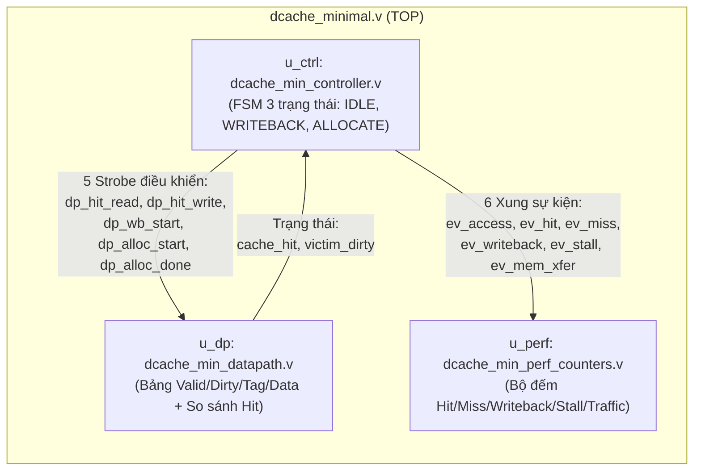

# Lộ Trình Xây Dựng & Nâng Cấp D-Cache Từ Sơ Khai Lên Hoàn Chỉnh

Tài liệu này hướng dẫn bạn đi từ **Mô hình D-Cache sơ khai nhất** ([`dcache_minimal.v`](file:///c:/Users/HUY/Desktop/DATN/minimal/dcache_minimal.v)) lên dần **Mô hình D-Cache 2-Way Set-Associative hoàn chỉnh** ([`riscv_dcache_2way.v`](file:///c:/Users/HUY/Desktop/DATN/rtl/riscv_dcache_2way.v)), đồng thời giải thích cách thu thập và phân tích các thông số tốc độ xử lý ở từng bước.

---

## 1. Cấu Trúc Phân Khối Của Mô Hình Sơ Khai (`minimal/`)

Để dễ đọc, dễ quản lý và dễ debug trên Waveform ( đồng thời đồng bộ 1-1 với kiến trúc ở thư mục [`rtl/`](file:///c:/Users/HUY/Desktop/DATN/rtl)), mô hình sơ khai được chia thành **1 file Top + 3 khối chức năng độc lập**:

### Bảng ánh xạ 1-1 giữa Mô hình Sơ khai (`minimal/`) và Mô hình Hiện tại (`rtl/`):

| Khối chức năng | Mô hình Sơ khai (`minimal/`) | Mô hình Hoàn chỉnh (`rtl/`) | Sự khác biệt chính |
| :--- | :--- | :--- | :--- |
| **Top-level** | [`dcache_minimal.v`](file:///c:/Users/HUY/Desktop/DATN/minimal/dcache_minimal.v) | [`riscv_dcache_2way.v`](file:///c:/Users/HUY/Desktop/DATN/rtl/riscv_dcache_2way.v) | Nối dây giữa 3 khối `u_ctrl`, `u_dp`, `u_perf` |
| **Controller (FSM)** | [`dcache_min_controller.v`](file:///c:/Users/HUY/Desktop/DATN/minimal/dcache_min_controller.v) | [`dcache_controller.v`](file:///c:/Users/HUY/Desktop/DATN/rtl/dcache_controller.v) | 3 trạng thái (`IDLE`, `WRITEBACK`, `ALLOCATE`) vs. 5 trạng thái (thêm `WB_DRAIN`, `UNCACHED`, `FLUSH` + bộ đếm `word_cnt`) |
| **Datapath** | [`dcache_min_datapath.v`](file:///c:/Users/HUY/Desktop/DATN/minimal/dcache_min_datapath.v) | [`dcache_datapath.v`](file:///c:/Users/HUY/Desktop/DATN/rtl/dcache_datapath.v) | Mảng 1 chiều (`1-Way`, `1 word/line`) vs. Mảng 3 chiều (`2-Way LRU`, `4 words/line`, `Write Buffer`, `apply_wstrb`) |
| **Perf Counters** | [`dcache_min_perf_counters.v`](file:///c:/Users/HUY/Desktop/DATN/minimal/dcache_min_perf_counters.v) | [`dcache_perf_counters.v`](file:///c:/Users/HUY/Desktop/DATN/rtl/dcache_perf_counters.v) | Đếm chi tiết cả `Read/Write Hit`, `Read/Write Miss`, `Write-Backs`, `Stall`, `Traffic` |

---

## 2. Cách Debug Từng Khối & Thu Thập Thông Số

Khi mở Waveform hoặc xem code, bạn chỉ cần theo dõi đúng nhóm tín hiệu của từng khối:

1. **Khi muốn debug FSM & giao thức bắt tay (`u_ctrl` - [`dcache_min_controller.v`](file:///c:/Users/HUY/Desktop/DATN/minimal/dcache_min_controller.v))**:
   - Xem `state` (`0 = S_IDLE`, `1 = S_WRITEBACK`, `2 = S_ALLOCATE`).
   - Xem 5 xung lệnh 1 chu kỳ gửi sang Datapath:
     - `dp_hit_read`: Bật lên `1` khi CPU đọc trúng Cache.
     - `dp_hit_write`: Bật lên `1` khi CPU ghi trúng Cache.
     - `dp_wb_start`: Bật lên `1` khi phát hiện Miss mà dòng cũ đang bẩn (`victim_dirty = 1`).
     - `dp_alloc_start`: Bật lên `1` khi bắt đầu phát địa chỉ xuống RAM để nạp dòng mới.
     - `dp_alloc_done`: Bật lên `1` khi RAM trả `mem_ready = 1` ở trạng thái `S_ALLOCATE`.

2. **Khi muốn debug địa chỉ, Tag và dữ liệu trong Cache (`u_dp` - [`dcache_min_datapath.v`](file:///c:/Users/HUY/Desktop/DATN/minimal/dcache_min_datapath.v))**:
   - Xem `req_tag` (`cpu_addr[31:8]`) và `req_index` (`cpu_addr[7:2]`).
   - Xem `valid_array[req_index]`, `dirty_array[req_index]`, `tag_array[req_index]`, `data_array[req_index]`.
   - Xem `cache_hit` và `victim_dirty`.

3. **Khi muốn thu thập thông số tốc độ xử lý (`u_perf` - [`dcache_min_perf_counters.v`](file:///c:/Users/HUY/Desktop/DATN/minimal/dcache_min_perf_counters.v))**:
   - Xem 6 xung sự kiện `ev_access`, `ev_hit`, `ev_miss`, `ev_writeback`, `ev_stall`, `ev_mem_xfer`.
   - Công thức tính tốc độ xử lý trung bình (`AMAT`):
     $$\text{AMAT} = 1 + \frac{\text{cnt\_stall\_cycles}}{\text{cnt\_accesses}} \quad (\text{cycles/access})$$

---

## 3. Lộ Trình 4 Bước Tự Build Up Theo Từng Khối Nhỏ

Vì đã tách thành 3 file riêng, mỗi bước nâng cấp bạn chỉ cần chạm vào đúng phần liên quan:

### Bước 1: Mở rộng từ 1 Word/Line lên 4 Words/Line (Spatial Locality)
- **Tại [`dcache_min_controller.v`](file:///c:/Users/HUY/Desktop/DATN/minimal/dcache_min_controller.v)**:
  - Thêm thanh ghi `output reg [1:0] word_cnt;`.
  - Trong `S_WRITEBACK` và `S_ALLOCATE`, khi `mem_ready == 1`, nếu `word_cnt < 3` thì tăng `word_cnt <= word_cnt + 1` (chưa chuyển trạng thái vội); chỉ khi `word_cnt == 3` mới chuyển trạng thái.
- **Tại [`dcache_min_datapath.v`](file:///c:/Users/HUY/Desktop/DATN/minimal/dcache_min_datapath.v)**:
  - Đổi `OFFSET_BITS = 4`, tách thêm `wire [1:0] req_word = cpu_addr[3:2];`.
  - Mở rộng `data_array` thành `reg [31:0] data_array [0:NUM_SETS-1][0:3];`.
- **Kết quả đo**: Số lần Miss khi đọc mảng tuần tự 16 phần tử giảm ngay **75%** (từ 16 xuống 4).

### Bước 2: Nâng cấp từ Direct-Mapped (1-Way) lên 2-Way Set-Associative + LRU
- **Tại [`dcache_min_datapath.v`](file:///c:/Users/HUY/Desktop/DATN/minimal/dcache_min_datapath.v)** (hầu như chỉ sửa ở Datapath!):
  - Nhân đôi các mảng lưu trữ theo chiều `Way` (`[0:1]`) và thêm `reg lru_bit [0:NUM_SETS-1];`.
  - Kiểm tra `hit_way0` và `hit_way1` song song; chọn `victim_way` dựa theo `valid_array` và `lru_bit`.
- **Tại [`dcache_min_controller.v`](file:///c:/Users/HUY/Desktop/DATN/minimal/dcache_min_controller.v)**:
  - Chốt `saved_victim_way <= victim_way` khi bắt đầu Miss ở `S_IDLE`.
- **Kết quả đo**: Xóa bỏ hoàn toàn hiện tượng **Ping-Pong Conflict Miss** khi 2 mảng `A` và `B` có cùng `Set Index`.

### Bước 3: Thêm Write Buffer (Eviction Buffer 1 Dòng)
- **Tại [`dcache_min_datapath.v`](file:///c:/Users/HUY/Desktop/DATN/minimal/dcache_min_datapath.v)**:
  - Thêm thanh ghi `wb_data[0:3]`, `wb_base_addr`, `wb_valid`.
  - Khi có xung `dp_wb_load`, chép nhanh dòng Dirty vào `wb_data` trong 1 chu kỳ.
- **Tại [`dcache_min_controller.v`](file:///c:/Users/HUY/Desktop/DATN/minimal/dcache_min_controller.v)**:
  - Khi Miss ở `S_IDLE` dù `victim_dirty == 1`, chỉ phát xung `dp_wb_load` rồi nhảy **thẳng vào `S_ALLOCATE`** để nạp dữ liệu mới cho CPU chạy tiếp trước, sau đó mới sang `S_WB_DRAIN` xả Write Buffer xuống RAM.

### Bước 4: Bổ sung `cpu_wstrb` (Byte/Halfword), Uncached & Flush/Invalidate
- Thêm hàm `apply_wstrb` trong [`dcache_min_datapath.v`](file:///c:/Users/HUY/Desktop/DATN/minimal/dcache_min_datapath.v) và các trạng thái `S_UNCACHED`, `S_FLUSH` trong [`dcache_min_controller.v`](file:///c:/Users/HUY/Desktop/DATN/minimal/dcache_min_controller.v) để đạt tới đúng phiên bản [`rtl/riscv_dcache_2way.v`](file:///c:/Users/HUY/Desktop/DATN/rtl/riscv_dcache_2way.v).
